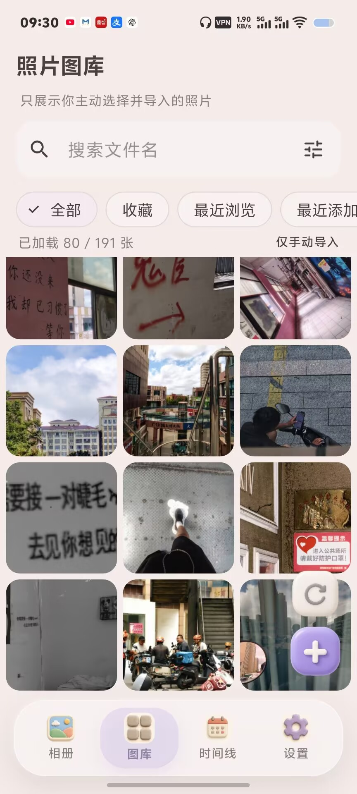

# 相册分类

`相册分类`（`photo_storer`）是一款面向 Android 的本地照片整理应用。它不会扫描或自动导入系统图库，用户可以按需选择照片，建立相册与子相册，再通过标签、筛选和时间线找到自己的照片。

应用采用温和的低饱和配色和黏土卡片式界面，适合把零散的照片整理成更容易回看的个人相册。

## ✨ 项目亮点

- **本地优先**：只处理用户主动选择并导入的照片，照片副本和相册资料保存在应用本地。
- **层级化整理**：支持相册、一级子相册、相册描述、彩色主题、图标和自定义封面。
- **隐私保护**：支持六位数字应用锁和独立的私密相册密码；AI 功能只发送照片元数据、照片故事和用户补充说明，不上传照片原图。
- **可迁移**：支持导出单个相册或完整相册包，也可以从完整备份中恢复相册资料、标签、浏览记录和照片文件。

## 📱 项目预览

<p align="center">
  
  
  
</p>

<p align="center">相册总览 · 照片图库 · 相册详情</p>

## 🚀 核心功能

### 相册与照片整理

- 创建、编辑、删除相册，并为相册设置颜色、图标、描述和封面。
- 创建一级子相册，照片可以关联到多个分类。
- 从 Android 系统照片选择器批量导入照片；导入时尽可能读取 EXIF 拍摄时间。
- 在照片详情中查看元数据、缩放浏览、标记收藏，并记录照片故事。

### 图库、搜索与时间线

- 图库提供全部照片、收藏、最近浏览和最近添加等智能入口。
- 支持按文件名、分类、标签、图片格式、画面方向、收藏状态和拍摄日期筛选。
- 按年、月组织照片的时间线视图。
- 支持批量添加/移除分类和标签、批量收藏，以及清理不可用照片记录。

### 导入、导出与备份

- 将照片保存回系统相册，或通过系统分享面板分享照片。
- 将单个相册打包为 ZIP 后分享。
- 导出“完整相册包”，包含照片、相册层级、封面、标签、收藏状态、浏览记录和私密相册凭据等资料；恢复前会校验备份格式和数据引用。

### 隐私与安全

- 首次使用时明确提示：应用不会扫描系统图库，只有主动选择的照片才会进入应用。
- 六位数字应用锁支持后台重新锁定、错误尝试限制和短暂锁定。
- 私密相册可以单独设置密码，并支持隐藏私密相册入口。
- 应用锁和私密相册密码以加盐哈希形式保存；AI API Key 通过 Android Keystore 加密保存。

### AI 朋友圈文案

- 选择一张或多张照片，填写场景说明并选择“自然日常”“文艺克制”“轻松幽默”或“电影旁白”等风格。
- 通过可配置的 DeepSeek API 生成最多三条文案，生成后可以编辑、复制或分享。
- AI 默认只接收文件名、拍摄时间、尺寸、照片故事、相册描述和补充说明，不接收照片原图。

## 🛠 技术栈

| 类型 | 技术 |
| --- | --- |
| 客户端 | Flutter / Dart |
| 目标平台 | Android |
| 状态管理 | Provider |
| 本地数据库 | sqflite / SQLite |
| 本地偏好 | shared_preferences |
| 文件与路径 | path_provider / path |
| 图片与媒体 | image_picker / photo_manager / gal / exif |
| 分享与安全 | share_plus / crypto / Android Keystore |
| AI 接口 | HTTPS Chat Completions API，默认配置为 DeepSeek |

## 🏗 项目结构

```text
lib/
├── core/                  # 常量、主题、反馈与安全控制
├── data/
│   ├── database/           # SQLite 数据库与版本迁移
│   ├── models/             # 照片、相册、标签等数据模型
│   ├── repositories/       # 数据访问与关联关系操作
│   └── services/           # 导入、导出、备份、封面与 AI 服务
├── features/
│   ├── home/               # 相册总览
│   ├── library/            # 照片图库、搜索与筛选
│   ├── timeline/           # 年月时间线
│   ├── theme_detail/       # 相册详情与子相册
│   ├── photo_viewer/       # 照片浏览与信息
│   ├── private_album/      # 私密相册验证
│   ├── app_lock/           # 应用锁
│   ├── ai/                 # AI 朋友圈文案
│   └── settings/           # 设置、标签和备份
├── widgets/                # 通用 UI 组件
├── app.dart                # 应用路由与主 Shell
└── main.dart               # 程序入口与 Provider 初始化
```

Android 原生侧通过 Flutter Platform Channel 提供安全存储、图片格式兼容处理、ZIP 打包和备份文件选择等能力。`test/` 中包含数据层、应用锁、主题卡片和 Widget 测试。

## ⚙️ 快速开始

### 环境要求

- Flutter SDK（项目要求 Dart `^3.2.0`）
- Android SDK、Platform-Tools 和可用的 Android 设备或模拟器
- Android 构建使用 Java/Kotlin 17 配置

### 安装依赖

```bash
flutter pub get
```

### 运行

项目定义了 `standard` 和 `zero` 两个 Android product flavor。日常运行标准版本可以使用：

```bash
flutter run --flavor standard
```

也可以在 Android Studio 或 VS Code 中选择对应的 Flutter 启动配置运行。

### 构建并部署到真机

Windows 环境下，先确保手机已开启 USB 调试或无线调试，并且 `adb devices` 可以识别设备，然后在项目根目录运行：

```text
deploy.bat
```

脚本会构建 `standardDebug`，通过 ADB 覆盖安装并启动应用，同时保留已有应用数据。使用 Android 11 及以上设备进行无线调试时，可先运行：

```text
connect-phone.bat
```

### 测试

```bash
flutter test
```

## 🔐 AI 配置

进入应用的“设置 → AI 服务”，填写：

- API 地址（必须是 HTTPS 地址）
- 模型名称
- API Key

配置页提供连接测试和恢复 DeepSeek 默认配置的功能。API Key 不会写入 README 或普通配置文件，而是交由 Android Keystore 加密保存在当前设备的应用数据空间中。

## 📄 数据与隐私说明

应用只导入用户在系统照片选择器中主动选中的图片，并将导入副本存放在应用自己的数据目录；从相册中移除分类不会删除设备原图。使用 AI 文案功能时，当前实现不会上传照片原图，但会将所选照片的文件名、拍摄时间、尺寸、照片故事、相册描述和补充说明发送到配置的 AI 服务，请根据自己的隐私需求配置服务地址和内容。
